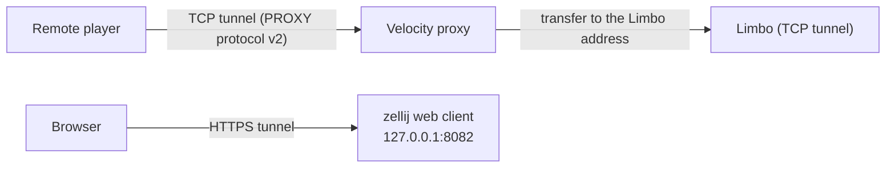

# Sharing the dev network

Let other people join your dev network and share a whole mcdev setup. Part of the [development environment](environment.md).

- [Joining from outside](#joining-from-outside)
- [Public tunnels (`mcdev share`)](#public-tunnels-mcdev-share)
- [Browser access to the consoles (`mcdev web`)](#browser-access-to-the-consoles-mcdev-web)
- [Sharing a setup (profiles)](#sharing-a-setup-profiles)

## Joining from outside

The dev container's compose file publishes the first proxy's port (`MCDEV_PROXY_PORT`, default 25565) on all host interfaces, so other machines can join using the host's address; publish more ports for other proxies or standalone servers you want to reach directly. Backend and debug ports stay inside the container. Players that are *transferred* between servers (for example to a standalone waiting-room server and back) need the addresses the proxy hands out to be reachable by them: set `public_host` in `.mcdevtools/config.local.toml` to your LAN or public address (default `localhost`), and `public_port` on an instance if you remapped a published port. On Windows with WSL2, forward the port from Windows to WSL (or use mirrored networking) and allow it through the firewall. In Codespaces or on a remote Docker host, forward the port manually.

## Public tunnels (`mcdev share`)

| Command | What it does |
| --- | --- |
| `mcdev share start [targets...]` | Open tunnels for the named targets and keep them renewed (default targets: `share.targets`, else every proxy and standalone instance; a checkbox menu on a terminal). `--provider <name>` picks the tunnel service, `--foreground` runs the daemon in this terminal instead of the background |
| `mcdev share status` | Tunnel addresses and when they renew |
| `mcdev share logs [-f]` | The daemon's log (`-f` follows it) |
| `mcdev share stop` | Close the tunnels and restore `public_host` |
| `mcdev share providers` | The available tunnel services |

`mcdev share start` opens public tunnels, so people outside your network can join without port forwarding. Every proxy and every standalone instance is a target (named after the instance), plus `web`: instances are tunnelled over TCP, the zellij web console over HTTPS (it needs the default `web.bind = "127.0.0.1"`; the tunnel provides the TLS). While tunnels are live, `mcdev share` re-renders every proxy's preset configs with the tunnel addresses (the `PUBLIC_HOST_<NAME>` / `PUBLIC_PORT_<NAME>` [template variables](environment.md#templates)), then runs the platform's reload command on the running proxies (`velocity reload` for Velocity) and fires the `shareAddressesChanged` hook, where an [extension](extensions.md) reloads project-specific config. `mcdev share stop` restores `public_host`. The `afterShareStart` hook lets an extension print warnings, for example about a standalone server that is not shared.

The default provider is [Pinggy](https://pinggy.io) through its Node SDK (an optional dependency with a native addon, downloaded on `pnpm install`). Without an account its tunnels last **60 minutes** and get random addresses, so a background daemon (`mcdev share logs -f` follows it) renews them about 30 seconds early (`share.renew_before_seconds`), reopens tunnels that drop, and publishes the new addresses. **Each renewal changes the address and disconnects players who joined through it.** A Pinggy token (`[share.providers.pinggy] token` in `config.local.toml`, or `PINGGY_TOKEN`) removes the limit and keeps the address stable. Never put the token in `config.toml`; profiles never carry `share` settings.

By default the proxy tunnel sends the PROXY protocol (`share.proxy_protocol = "v2"`) and `velocity.toml` gets `haproxy-protocol = true` while sharing, so Velocity sees the players' real addresses (and its per-IP `login-ratelimit` works per player). The catch is that Velocity then refuses connections without the header, including your own `localhost:25565`: join through the tunnel address while sharing, or set `share.proxy_protocol = "off"` (then every remote player appears as 127.0.0.1 and shares one rate limit). Limbo's tunnel never sends the header.

To add another tunnel service, see [Extension points](dev-tool.md#extension-points).

## Browser access to the consoles (`mcdev web`)

`mcdev web start` starts zellij's web client and creates the session in the background (`web_sharing "on"` in the generated config is what lets browsers attach; after changing it run `mcdev web stop`, `dev ui kill`, then `mcdev web start` since it needs a restart); open the printed URL and log in with a token (`mcdev web token`; `--read-only` tokens can only watch). It binds `127.0.0.1:8082` by default, which VS Code forwards from the container (`forwardPorts`). To expose it to the network set `web.bind = "0.0.0.0"` in `config.local.toml`: zellij then requires TLS, so a self-signed certificate is generated into `.mcdevtools/run/.zellij/tls` (browsers warn once), and the port must also be published in `docker-compose.yml` (a commented line is there). 

> **Warning:** anyone with a normal token has a full shell in the container. Hand out read-only tokens (`mcdev web token --read-only`) and keep the default bind unless you need more.

## Sharing a setup (profiles)

`mcdev profile export [name]` packs a working setup into `.mcdevtools/profiles/<name>.tar.gz`; `mcdev profile import <file>` applies one. You choose what goes in (`--include`, or the checkbox prompt):

| Section | Contents | On import |
| --- | --- | --- |
| `plugins` | the exact plugin list: URL, version and SHA-256 per platform; jars that cannot be fetched again byte for byte (`url` and `local` sources) are embedded, all of them with `--embed-jars` | pins are written to `config.local.toml`; `mcdev setup` re-downloads and verifies them |
| `servers` | Minecraft/Purpur/Velocity/Limbo builds and the effective server, proxy, JVM and UI setup | written to `config.local.toml`; your `accept_eula`, `public_host` and `web` are kept |
| `overrides` | `.mcdevtools/templates.local/` (see `mcdev override`) | replaces yours |
| `db` | `pg_dump` of every database in `[db].databases` that exists | restored; refuses if it has changelogs your checkout lacks (`--force`) |
| `worlds` | world directories of the chosen (stopped) servers | replace the current worlds |

Import treats the archive as untrusted: it rejects absolute paths, `..`, links and unexpected entries, prints a review (plugin download hosts, JVM flags, first-start console commands, what will be replaced) and asks before changing anything, then backs up `config.local.toml` and `templates.local` to `.mcdevtools/.profile-backup/`. Pass `--yes` only for archives you trust. `mcdev profile inspect` shows a profile without applying it. Config you edited under `.mcdevtools/run` is not exported unless you saved it with `mcdev override <instance> <path>`, which copies it into `.mcdevtools/templates.local/` (same layout as `.mcdevtools/templates/`, applied after it on every start).
